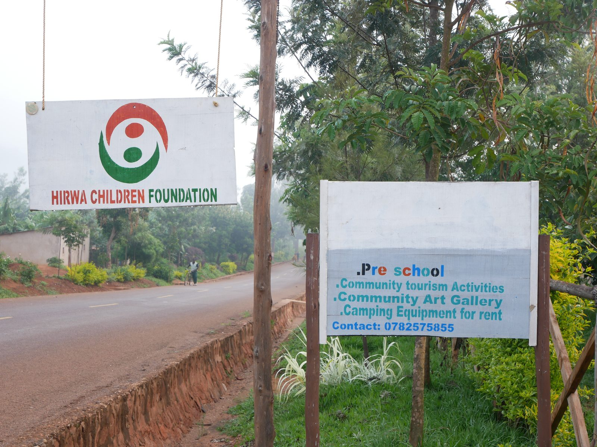

## Early life

I was born in 1992 in Kayonza District, in Rwanda's Eastern Province, and grew up in a poor family. I saw the hardship of poverty first-hand, but I refused to let it decide my future.

## Leaving school

I was eager to learn, but my family could not pay for school, and I had to drop out.

## Akagera National Park

In 2005 I went to Akagera National Park to look for a better life. I found work as a house boy for the park rangers, and the rangers and guides helped me with school materials, so I could go back to school.

Every day I walked 7 km to school and 7 km back, through the park. It was hard and sometimes dangerous, but I believed that knowledge is the key to a better future.

Over the years I grew from house boy to park guide for two years, and then worked five years as a waiter at Ruzizi Tented Lodge. I learned a lot about hospitality and tourism.

## Founding the foundation

My own journey made me want to give back to my community. I founded the Hirwa Children's Foundation to empower children from vulnerable families through education, with good schooling for the children and literacy classes for their parents.

## Where we are today

Thanks to hard work and the generous support of Mantis Collection and many friends, our preschool now teaches about 75 children every school day. Our team has 2 teachers, support staff and volunteers.

And we do more than teach. Together with the whole community we tackle malnutrition, health and money worries. [See our projects](/projects/).

I am grateful for the support that has shaped my life, and with God's grace I want to pass it on to the next generations.

— Jean Claude "John" Habihirwe, founder

