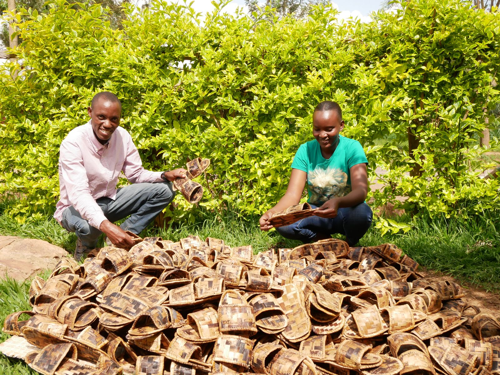
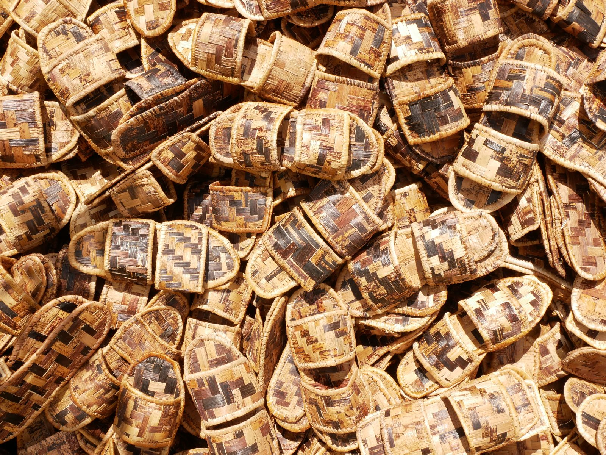

In a small community like ours, young single mothers face hard challenges: childcare, money worries and social stigma. We help them learn new skills that lead to financial independence, which improves life for both mother and child.

## Sandals workshop

Our first project taught mothers to craft sandals from banana leaves. Together they now make about **600 pairs every month**. The sandals are used in the rooms of these Mantis Collection hotels, which brings real income into the community:

- Mantis Kivu Marina Bay, Rusizi
- Mantis Epic Hotel & Suites, Nyagatare
- Mantis Akagera Game Lodge
- Kivu Queen Uburanga, Rusizi

