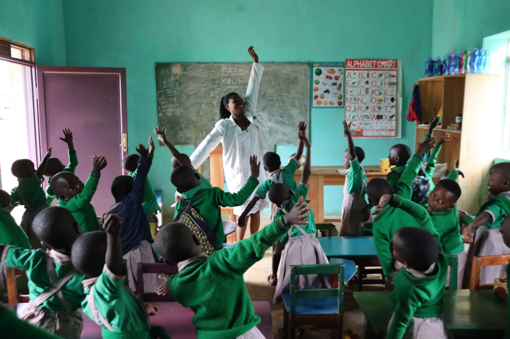
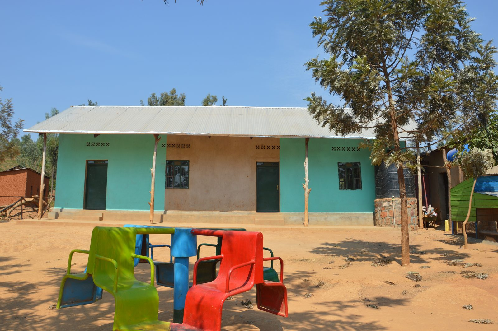

The Hirwa Children's Foundation's main mission is to give children living in poverty a free, high-quality education. We believe that education is the key to empowering our community, especially the poorest.

Our preschool is open **Monday to Friday from 8 am to 12 pm** and gathers about 75 children aged 3 to 6. The children are selected on social criteria, together with our local government. The programme prepares them for the move to the local primary school and gives them the keys to succeed there.

The children learn in two classes, with our two teachers and volunteers.

## A typical day at Hirwa preschool

| Time | What happens |
|---|---|
| 08:00 – 09:00 | Playing in the yard, learning through songs and prayers |
| 09:00 – 10:00 | Small-group learning through games |
| 10:00 – 11:30 | Lessons in maths, English or Kinyarwanda |
| 11:30 – 12:00 | A nourishing lunch before the children go home |

